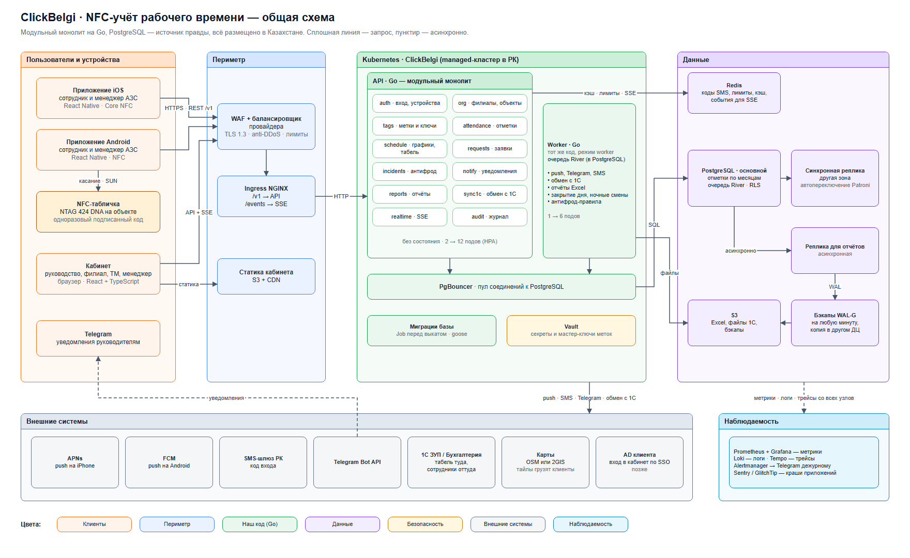
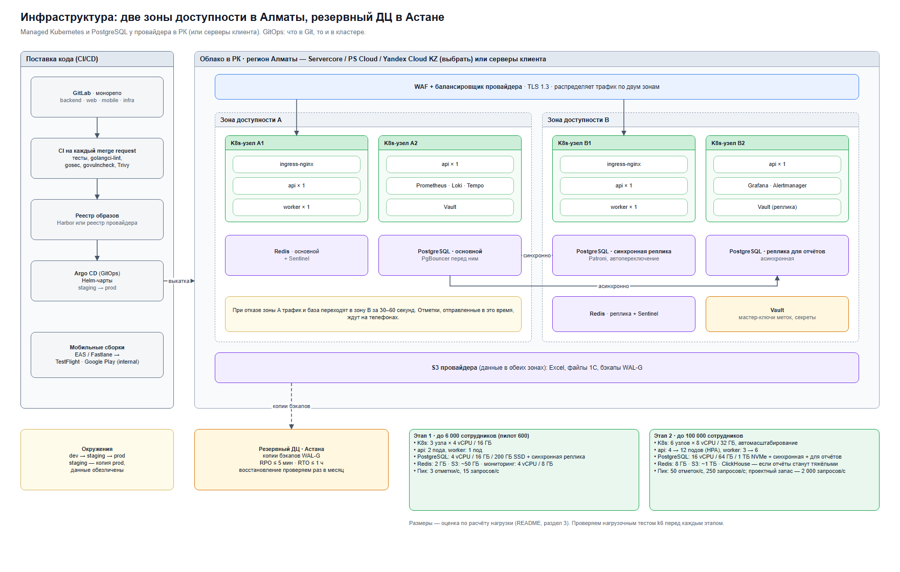
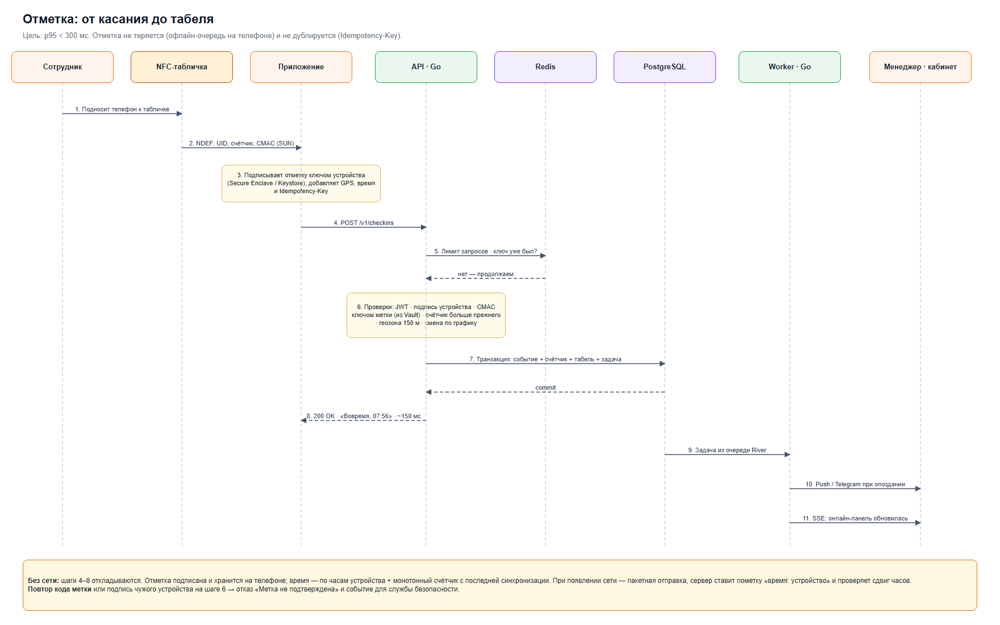
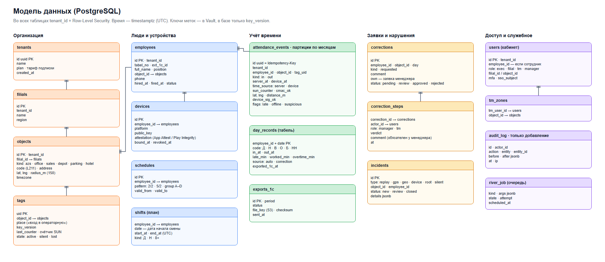

# ClickBelgi: архитектура боевой системы

Учёт рабочего времени по NFC для сети Qazaq Oil: 6 тысяч сотрудников на старте, до 100 тысяч позже (другие клиенты ClickBelgi). Документ для команды разработки: что строим, сколько нужно мощностей, на чём пишем и как разворачиваем.

Схема в draw.io: [`ClickBelgi_architecture.drawio`](ClickBelgi_architecture.drawio). Четыре листа: общая схема, инфраструктура, путь отметки, модель данных. Открыть: [app.diagrams.net](https://app.diagrams.net) → File → Open, или расширение Draw.io Integration в VS Code. Превью листов:

| Общая схема | Инфраструктура и мощности |
|---|---|
|  |  |
| **Путь отметки** | **Модель данных** |
|  |  |

---

## 1. Коротко

1. **Нагрузка небольшая.** 100 тысяч сотрудников — это около 50 отметок в секунду в пик пересменки и около 250 запросов к API в секунду. Один сервер на Go выдерживает это с большим запасом. Главная сложность не в мощности, а в точности: время, офлайн, повторы кода метки, обмен с 1С.
2. **Go — да.** Он хорошо подходит, но не из-за «наплыва»: даёт маленькие быстрые бинарники, простую поддержку и криптографию в стандартной библиотеке (нужна для проверки меток NTAG 424).
3. **Модульный монолит, не микросервисы.** Один сервис API и один фоновый Worker из того же кода. Масштабируем копиями. Делим на сервисы только когда упрёмся, а не заранее.
4. **PostgreSQL — единственный источник правды.** Очередь задач тоже в нём (River). Redis — только для временного: коды SMS, лимиты, кэш. Kafka и NoSQL не нужны.
5. **Всё хранится в Казахстане.** Managed Kubernetes и PostgreSQL у провайдера в РК (Servercore, PS Cloud или Yandex Cloud KZ), или на серверах Qazaq Oil.
6. **Сразу закладываем несколько клиентов.** ClickBelgi продаёт подписку, значит у каждой записи есть `tenant_id`, а изоляция — через Row-Level Security в PostgreSQL.
7. **Отметка не теряется и не дублируется.** Идентификатор отметки создаёт телефон (идемпотентность), офлайн-очередь на телефоне, одна транзакция на сервере.

---

## 2. Что строим

| Часть | Для кого | Технология |
|---|---|---|
| Приложение iOS и Android | сотрудник (отметка, история, заявка), менеджер АЗС (смена, заявки) | React Native + Expo, нативные модули для NFC, ключей и проверки устройства |
| Кабинет | руководство, директор филиала, ТМ, менеджер | React + TypeScript (развиваем текущий макет) |
| API | приложения и кабинет | Go, REST + OpenAPI |
| Worker | уведомления, обмен с 1С, отчёты, закрытие дня, антифрод | Go, тот же код, другой режим запуска |
| Telegram-бот | руководители | Go, внутри Worker |
| NFC-таблички | объекты | NTAG 424 DNA, подписанный одноразовый код (SUN) |

---

## 3. Нагрузка: 6 тысяч → 100 тысяч

**Допущения.** 75% сотрудников работают сменами 2/2 (день 08–20, ночь 20–08, группы A–D), 25% — в офисах 5/2. Отметка — приход и уход. Пик — пересменка в 08:00: дневная группа приходит, ночная уходит, это 50% сменных сотрудников за ~25 минут; в самую плотную минуту — 8% от этого. На одну отметку приложение делает ~5 запросов (отметка, статус, график, синхронизация, push-токен).

| | Пилот (600) | 6 000 | 100 000 |
|---|---:|---:|---:|
| Отметок в сутки | ~660 | ~6 600 | ~111 000 |
| Отметок за пересменку (25 мин) | ~225 | ~2 250 | ~37 500 |
| Отметок в пиковую минуту | ~18 | ~180 | ~3 000 |
| **Отметок в секунду в пик** | 0,3 | 3 | **50** |
| **Запросов к API в секунду в пик** | 2 | 15 | **250** |
| Записей в базу в секунду в пик (×4 на отметку) | 1 | 12 | 200 |
| Событий в год | 0,2 млн | 2,4 млн | 40 млн |
| Объём событий в год (~1 КБ с индексами) | 0,2 ГБ | 2,3 ГБ | ~40 ГБ |

**Проектная мощность — 2 000 запросов в секунду**: это 8-кратный запас к пику при 100 тысячах. Проверяем нагрузочным тестом (k6) перед каждым этапом.

**Что на самом деле будет узким местом:**

- **Первый вход всех сразу.** 100 тысяч SMS с кодами за неделю запуска. Решение: запуск по филиалам, лимиты на повторную отправку, договор с SMS-шлюзом на нужный объём.
- **Плохая связь на АЗС.** Решение: офлайн-режим в приложении, отметка подписывается на телефоне и уходит позже.
- **Тяжёлые отчёты** (год по 100 тысячам человек). Решение: отдельная реплика базы для отчётов, Excel собирается в фоне, а не в запросе.
- **Онлайн-панель у тысяч руководителей.** Решение: одно соединение SSE на вкладку вместо опроса каждые 5 секунд, рассылка изменений через Redis.

---

## 4. Язык бэкенда: Go

| | Go | Java / Kotlin (Spring) | Node.js (TypeScript) | C# (.NET) |
|---|---|---|---|---|
| Производительность на ядро | высокая | высокая | средняя | высокая |
| Память на копию сервиса | 30–80 МБ | 300–600 МБ | 80–150 МБ | 100–200 МБ |
| Старт и деплой | секунды, один файл | дольше, JVM | быстро | быстро |
| Криптография для меток (AES-CMAC) | стандартная библиотека + 50 строк | есть | есть | есть |
| Порог входа для команды | низкий, язык маленький | высокий | низкий | средний |
| Общий код с фронтендом | нет | нет | да | нет |

**Решение: Go.** Скорость, малое потребление памяти, простой код и предсказуемая работа под нагрузкой. Минус: нельзя делить код с фронтендом. Компенсируем генерацией типов TypeScript из OpenAPI: и кабинет, и приложение получают готового клиента API.

---

## 5. Архитектура бэкенда: модульный монолит

Один репозиторий, один бинарник, два режима запуска: `api` (HTTP) и `worker` (фоновые задачи). Модули общаются через Go-интерфейсы, у каждого свои таблицы. Чужие таблицы напрямую не читаем.

| Модуль | Что делает |
|---|---|
| `auth` | вход по телефону и SMS, привязка устройства (ключ в Secure Enclave / Keystore), JWT на 15 минут + refresh, роли и области видимости |
| `org` | клиенты, филиалы, объекты, зоны ТМ, сотрудники (загрузка из 1С) |
| `tags` | реестр NFC-меток, ключи (выводятся из мастер-ключа в Vault), последний счётчик |
| `attendance` | приём отметок: проверки, запись, статус «вовремя / опоздание» |
| `schedule` | графики 2/2 и 5/2, смены через полночь, праздники, табель по дням |
| `requests` | заявки: сотрудник → менеджер АЗС (комментарий обязателен) → ТМ |
| `incidents` | антифрод: повтор кода, подмена GPS, root, «молчащая» метка, частые правки |
| `notify` | push (APNs, FCM), Telegram, SMS |
| `reports` | отчёты, Excel, аналитика (читает реплику) |
| `sync1c` | выгрузка табеля в 1С, загрузка сотрудников |
| `realtime` | SSE для онлайн-панели |
| `audit` | журнал всех изменений, только добавление |

**Почему не микросервисы.** При 2–5 разработчиках и 250 запросах в секунду микросервисы дают только расходы: сетевые вызовы, распределённые транзакции, 10 деплоев вместо одного. Модульный монолит масштабируется копиями до сотен тысяч пользователей.

**Когда выносить модуль в отдельный сервис:** у него своя нагрузка, которая мешает остальным (например, отчёты), или над ним постоянно работает отдельная команда.

---

## 6. Данные

| Хранилище | Для чего | Как настроено |
|---|---|---|
| **PostgreSQL** | всё постоянное: сотрудники, отметки, табель, заявки, аудит, очередь задач | основной сервер + синхронная реплика в другой зоне (Patroni, автопереключение) + асинхронная реплика для отчётов; PgBouncer; события разбиты на партиции по месяцам |
| **Redis** | коды SMS, лимиты запросов, кэш графиков, рассылка событий для SSE | 3 узла с Sentinel; потеря данных не страшна |
| **River** (очередь на PostgreSQL) | задачи Worker: уведомления, 1С, отчёты | задача ставится в той же транзакции, что и отметка, поэтому не теряется |
| **S3** | файлы Excel и 1С, бэкапы | у провайдера, копия бэкапов в другом ДЦ |
| **Vault** | секреты, мастер-ключи меток NTAG | ключи не лежат в коде и в базе |
| ClickHouse (позже) | тяжёлая аналитика за годы | только если отчёты на реплике станут медленными |

**Несколько клиентов в одной базе.** В каждой таблице `tenant_id`, включён Row-Level Security: даже ошибка в запросе не покажет чужие данные. Если крупный клиент потребует отдельную установку — разворачиваем тот же код отдельно.

**Время.** Храним только UTC (`timestamptz`) и часовой пояс объекта. С 1 марта 2024 года весь Казахстан живёт в UTC+5, но поле часового пояса оставляем на случай изменений и других стран. Смена через полночь относится к дате начала смены.

Модель данных — лист 4 схемы.

---

## 7. Путь отметки и гарантии

Подробно — лист 3 схемы.

1. Телефон читает с метки NDEF-ссылку: UID, счётчик, CMAC (SUN).
2. Приложение подписывает отметку ключом устройства и добавляет GPS, время и `Idempotency-Key` (UUID).
3. `POST /v1/checkins`. API проверяет: JWT → подпись устройства → CMAC ключом метки → счётчик больше прежнего → геозона 150 м → смена по графику.
4. Одна транзакция: событие + новый счётчик метки + день табеля + задача в очередь.
5. Ответ «Вовремя, 07:56» за ~150 мс. Push и Telegram руководителю — уже из Worker.

**Гарантии:**

- **Не дублируется.** Повтор с тем же `Idempotency-Key` возвращает прежний ответ.
- **Не подделать.** Счётчик метки проверяется атомарно: `UPDATE tags SET last_counter = $1 WHERE uid = $2 AND last_counter < $1`. Повтор кода и копия метки не пройдут.
- **Не теряется без сети.** Отметка подписана и ждёт в очереди на телефоне. Время — по часам устройства плюс монотонный счётчик с последней синхронизации. Сервер ставит пометку «время: устройство» и проверяет сдвиг часов.

**Целевые показатели:** p95 приёма отметки < 300 мс; доступность API 99,9% (≈43 минуты простоя в месяц); при простое отметки копятся на телефонах и досылаются.

---

## 8. Клиенты

**Мобильное приложение: React Native + Expo.** Кабинет уже на React и TypeScript, команда пишет на одном языке, общие типы API и переводы. Всё, что касается безопасности, пишем нативными модулями (Swift / Kotlin):

- чтение NFC — `react-native-nfc-manager`;
- ключ устройства в Secure Enclave / Android Keystore;
- проверка устройства: App Attest на iOS, Play Integrity на Android.

На нативные модули — 1–2 недели. Полностью нативные приложения на Swift и Kotlin надёжнее, но это две кодовые базы. Имеет смысл, только если будут отдельные iOS- и Android-разработчики.

**Кабинет.** Развиваем текущий макет: Vite, React, TypeScript, Tailwind. Данные — через сгенерированный из OpenAPI клиент, онлайн-панель — через SSE. Статика отдаётся из S3/CDN.

**Telegram-бот.** Webhook в Worker. Только уведомления и быстрые действия (подтвердить заявку). Персональные данные в Telegram — минимально.

---

## 9. Интеграции

| Система | Как | Кто отвечает со стороны клиента |
|---|---|---|
| 1С ЗУП / Бухгалтерия | выгрузка табеля: файл (XML/CSV) по расписанию или HTTP-сервис 1С; загрузка сотрудников оттуда же | специалист 1С клиента |
| SMS | местный SMS-шлюз (договор на объём), только для кода входа | — |
| Push | APNs (Apple), FCM (Google) | — |
| Карты | тайлы OpenStreetMap или 2GIS, клиенты грузят напрямую | — |
| Вход в кабинет | своя авторизация с 2FA; позже SSO через OIDC к AD клиента | ИТ клиента |

Обмен с 1С идёт через очередь: если 1С недоступна, задача повторится. Каждая выгрузка сохраняется в S3 с контрольной суммой — можно доказать, что именно ушло.

---

## 10. Инфраструктура и DevOps

**Хостинг в Казахстане.** Персональные данные граждан РК по закону № 94-V должны храниться в базе на территории РК (статья 12). Актуальную редакцию нужно проверить с юристом: с 12 июля 2026 года действует Цифровой кодекс.

Варианты провайдера (managed Kubernetes и PostgreSQL):

- **Servercore** — Алматы, есть managed Kubernetes и базы данных.
- **PS Cloud Services** — зоны Алматы и Астана, managed Kubernetes.
- **Yandex Cloud** — регион в Казахстане, managed Kubernetes и PostgreSQL.
- **Серверы Qazaq Oil** — если ИБ не разрешит внешнее облако. Тогда k3s / RKE2 и PostgreSQL с Patroni на их машинах.

Решение принимаем после разговора с ИБ клиента. Цены и SLA запрашиваем у двух-трёх провайдеров.

**Kubernetes.** Он с первого дня, потому что дальше рост в 15 раз и несколько клиентов. Managed-кластер у провайдера, Helm-чарты, Argo CD (GitOps: что в Git, то и в кластере). Если провайдер даёт managed PostgreSQL — берём его, а не держим базу в Kubernetes.

**Окружения:** `dev` → `staging` (копия prod, данные обезличены) → `prod`.

**CI/CD:**

- монорепо `backend / web / mobile / infra`;
- на каждый merge request: тесты, golangci-lint, gosec, govulncheck, Trivy;
- образ → реестр → Argo CD;
- миграции базы — отдельный Job до выката, только обратно совместимые (сначала добавить, потом убрать);
- мобильные сборки через EAS или Fastlane → TestFlight и Google Play (internal testing).

**Наблюдаемость:**

- OpenTelemetry → Prometheus и Grafana (метрики), Loki (логи), Tempo (трейсы);
- Alertmanager → Telegram дежурному;
- краши приложений — self-hosted Sentry или GlitchTip (данные остаются в РК).

**Бэкапы.** WAL-G: восстановление на любую минуту, копия в другом ДЦ (Астана). Восстановление проверяем раз в месяц. RPO ≤ 5 минут, RTO ≤ 1 час.

---

## 11. Мощности по этапам

| | Этап 1: до 6 000 (пилот 600) | Этап 2: до 100 000 |
|---|---|---|
| Kubernetes | 3 узла × 4 vCPU / 16 ГБ | 6 узлов × 8 vCPU / 32 ГБ, автомасштабирование узлов |
| API | 2 пода × (1 vCPU / 1 ГБ) | 4 → 12 подов (HPA по CPU и p95) |
| Worker | 1 под | 3 → 6 подов |
| PostgreSQL | 4 vCPU / 16 ГБ / 200 ГБ SSD + синхронная реплика | 16 vCPU / 64 ГБ / 1 ТБ NVMe + синхронная + реплика для отчётов |
| Redis | 2 ГБ, 3 узла | 8 ГБ, 3 узла |
| S3 | ~50 ГБ | ~1 ТБ |
| Мониторинг | 4 vCPU / 8 ГБ | 8 vCPU / 16 ГБ |
| Пик | 3 отметки/с, 15 запросов/с | 50 отметок/с, 250 запросов/с |

**Когда добавлять мощности:**

| Сигнал | Действие |
|---|---|
| p95 API > 300 мс или CPU подов > 60% | HPA добавляет поды (автоматически) |
| CPU PostgreSQL > 60% в пик | больше ядер основному серверу, тяжёлые запросы → реплика |
| > 300 активных соединений к базе | PgBouncer в режим transaction, проверить пулы |
| Отчёт за год > 30 секунд | агрегаты по дням или ClickHouse |
| Очередь Worker > 1 000 задач дольше 5 минут | больше подов Worker |
| Новый крупный клиент с требованием изоляции | отдельная установка того же кода |

---

## 12. Безопасность (кратко)

- TLS 1.3 везде, WAF провайдера, лимиты запросов по устройству и IP.
- Ключи меток — в Vault. На каждую метку свой ключ, выведенный из мастер-ключа (NXP AN10922).
- Геопозиция — только в момент отметки, не трекинг.
- Аудит всех изменений табеля и заявок, только добавление.
- Шифрование дисков и бэкапов. Доступ к prod — только через VPN и с 2FA, все действия логируются.
- Пентест до запуска на всю сеть.
- Ответы на вопросы ИБ клиента — в `Petroretail_NFC_интеграция_и_безопасность.pdf`.

---

## 13. Стек для команды

**Backend (Go):**

- HTTP: `chi`, OpenAPI 3.1 + `oapi-codegen`;
- база: `pgx/v5`, `sqlc` (SQL пишем руками, код генерируется), `goose` (миграции);
- очередь: `riverqueue/river`;
- логи и трейсы: `log/slog`, OpenTelemetry;
- тесты: `testcontainers-go` (настоящий PostgreSQL в тестах), `k6` (нагрузка);
- AES-CMAC для SUN: своя реализация по NIST SP 800-38B, проверяем на тестовых векторах NXP AN12196.

**Web:** Vite, React, TypeScript, TanStack Query, клиент API из OpenAPI.

**Mobile:** Expo (dev client), React Native, нативные модули NFC, ключей и проверки устройства.

**Infra:** Terraform (облако), Helm, Argo CD, GitLab CI.

**Правила:**

- Каждое изменение API — сначала в OpenAPI, потом код.
- Каждое изменение схемы базы — миграция, обратно совместимая.
- Код-ревью обязательно; в `main` только через merge request с зелёным CI.
- Новые возможности — за флагами, чтобы выкатывать без риска.

---

## 14. План на 12 недель (совпадает с презентацией)

| Недели | Backend и DevOps | Клиенты |
|---|---|---|
| 1–2 | кластер, CI/CD, staging, схема базы, OpenAPI | дизайн по макету |
| 2–5 | auth, org, tags, attendance, schedule | кабинет: обзор, объект, сотрудник |
| 4–7 | requests, notify, realtime, нагрузочный тест | приложение: вход, отметка, офлайн, заявки |
| 5–10 | sync1c, reports, incidents | кабинет: табель, отчёты, заявки, Мои АЗС |
| 7 | — | приложение готово к тестам (TestFlight, internal testing) |
| 8–10 | **пилот, этап 1: офисы и центры продаж** | |
| 11–12 | старт этапа 2: АЗС, нефтебазы, автобазы, по филиалам | |

---

## 15. Риски и что уточнить

| Что | Почему важно | Кто решает |
|---|---|---|
| Где хостим: облако в РК или серверы клиента | от этого зависят сроки инфраструктуры | ИБ клиента, мы |
| Требования закона № 94-V и Цифрового кодекса | локализация, согласие, сроки хранения | юрист |
| Сколько сотрудников без телефона с NFC | запасной способ отметки | HR клиента |
| Формат обмена с 1С | файл быстрее, онлайн сложнее | специалист 1С |
| Объём SMS на запуск | стоимость и лимиты шлюза | мы, шлюз |
| Политика Apple для корпоративных приложений | способ раздачи на iPhone | мы |

---

Источники по хостингу и закону (проверены поиском 26.11.2026; детали сверить у провайдеров и юриста):

- [Yandex Cloud в Казахстане](https://yandex.cloud/ru-kz/blog/gm-yc-kz)
- [Servercore выходит на рынок Казахстана](https://astanahub.com/en/blog/servercore-vykhodit-na-rynok-kazakhstana)
- [Облачные провайдеры в Алматы — Data Center Map](https://www.datacentermap.com/cloud/g/kazakhstan/almaty/)
- [PS Cloud Services](https://www.ps.kz/)
- [Персональные данные и локализация в Казахстане в 2026 году — UPPERSETUP](https://uppersetup.com/ru/blog/personal-data-and-localisation-in-kazakhstan-in-2026-law-no)
- [Закон РК № 94-V «О персональных данных и их защите»](https://pavlodar.com/zakon/?all=all&dok=05410)
